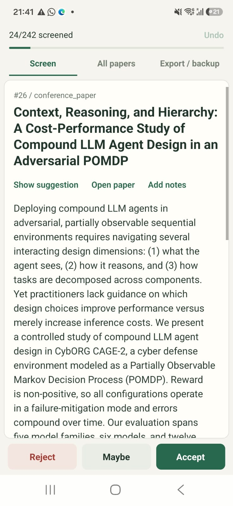
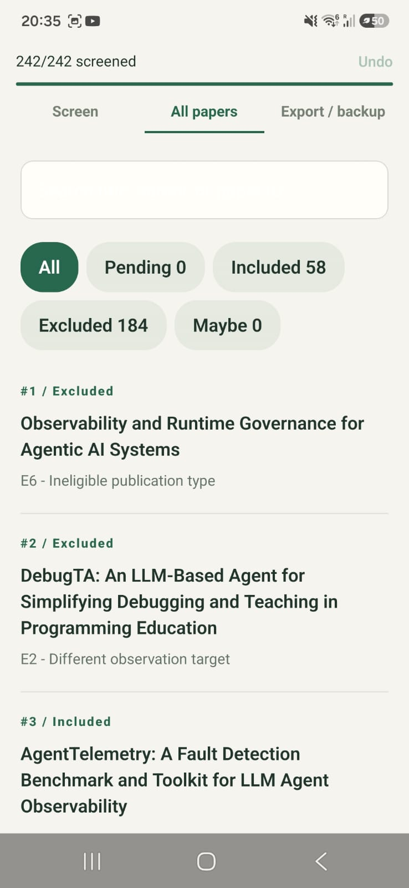
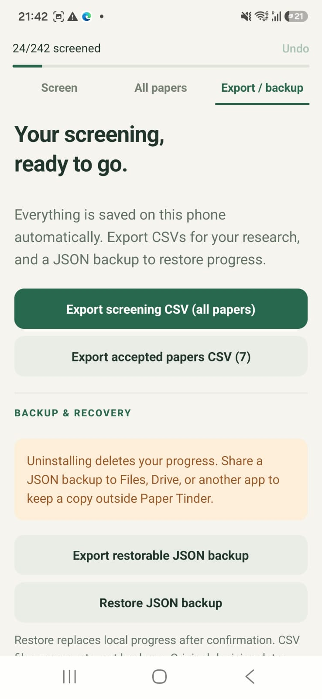
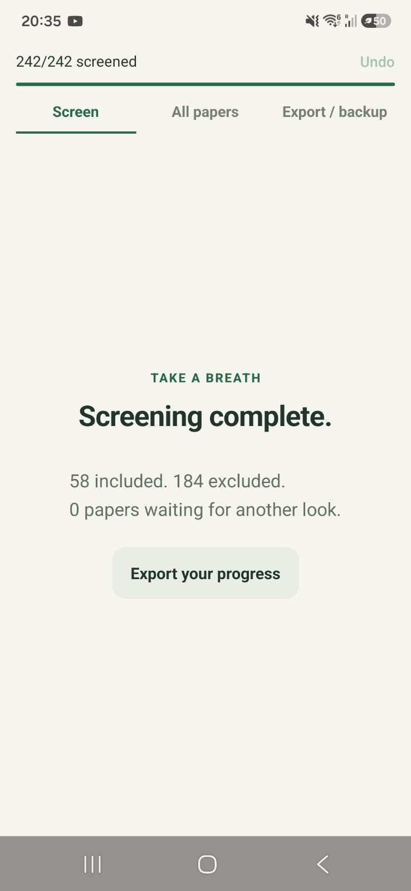

**TLDR;** I had a bunch of papers to analyze and was annoyed about the number of clicks that I had to do for one simple analysis. So I created a little app for classifying the papers

project link: https://github.com/rubuy-74/paper-tinder

I'm currently on the last year of my Masters and I'm working on my thesis. The thesis theme is "How engineers observe AI? A study on heuristics, patterns and anti-patterns for agent observability". It's a survey research for identifying the patterns and heuristics being used on the industry regarding agent observability by interviewing experienced engineers.

Before actually drafting the interview questions and talking to the interviewees I first need to determine the state of the art of agent observability, strategies and what it's currently being done. For that, I'm working on a systematic literature review. It starts by defining queries based on the research questions, creating exclusion (and inclusion) criteria for integrating papers into the research or not

After querying the databases and removing the duplicates between them I got around 240 papers that I have to analyze and categorize in exclusion and inclusion criteria.  I don't about you but at least for me, this looks like a lot of papers.

So what did I do? I created an app to be able to accept or deny the eligibility of the paper based on its abstract and its title.

But why not just do the classification manually? So, I have this spreadsheet with the exported papers from my queries and I needed to classify them into the categories but this took a few clicks, clicking on the PDF, actually reading the abstract and thinking about the categorization and then filling out the row for that paper.

With this little application, I only click twice. One for deciding if the paper is actually relevant and if not, another click on a dialog to decide the exclusion criteria.

Some  additional requirements that were important for me:
- Export a CSV for the screening and the accepted papers
- Add additional notes for context on the acceptance of the papers
- A clear view of the abstract and title
- A search page to see the current state of the papers, with a view of the notes and decision taken for each paper
- It would be nice to have an AI suggestion of the exclusion criteria from an LLM model

With all of that in mind I cooked up the following prompt and a after a few tweaks to the UI, the app was done.

```
I have the following idea: I need to review the abstract and title of 242 papers (on @data/papers.csv) until sunday based on the critea that I defined on @data/criteria.csv.

I want to have a tinder like experience where a given paper is shown with its title and abstract readable and I can swipe left to decline it and right to categorize as accepted.

If rejected, there should have a dialog that asks for the reason (one of the exclusion criteria), an option to put it as a maybe and then it shows up again on the slider after all of the others , and an optional textbox for adding notes about it

There's also already a hint if the paper is suitable or not and I want it to show that information as a hint for each one of the papers.

This should be an Expo react native app that I can compile and install the apk on my phone, be able to export the current screening state to a csv file with the following information: Paper ID, Title, PDF Link, Title/abstract decision, Title/abstract decision date, Exclusion Criteria and Notes. I should also be able to export the accepted papers with the same columns as the original @data/papers.csv 

Use the grill-me skill so we are in the same length for implementation

Before everything ask me about the papers that I already classified manually  for me to put in the repository please
```

What came of it worked really well for me and it 100% accelerated the work and gave me much more time to analyze the actual contents of the papers (what I'm doing nowadays). These are screenshots of the most relevant parts of the app


<div class="image-row">    </div>


This is not a technical showcase of some complicated thing but some words about how simply you can just make stuff now. It's just incredible the things you can do in 30 minutes and how that can really makes things easier for you. I will definitely be exploring much more this Personal Software world.

If you want something like this you can just shoot me a message or if you just want to rant about your thesis (as I surely already did with my friends), you can shoot me a message on twitter, linkedin or an email.

twitter: https://x.com/rubuy_74 \
linkedin: https://www.linkedin.com/in/rubemneto74/ \
email: rubemviscard2635@gmail.com
